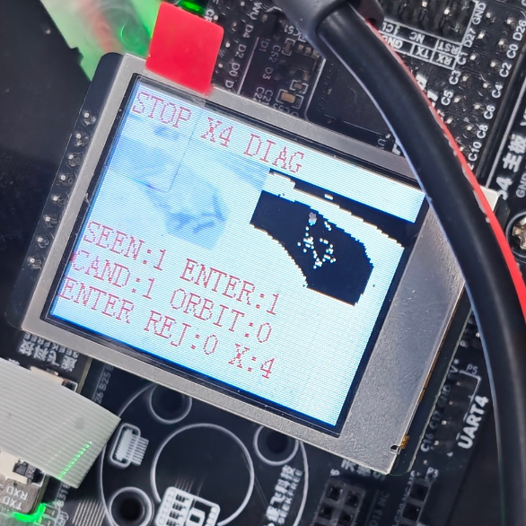
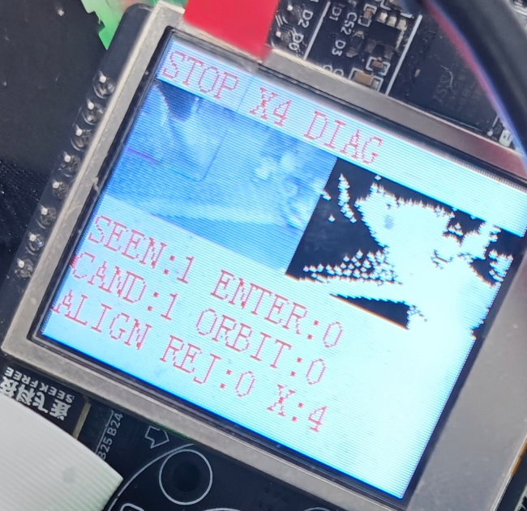

# SCAN9U 环岛屏显测试

车上测试版为 `C11SCAN9U-RING-TEST`。基于 SCAN9U-LATE，在 LCD 上保留本次行驶的环岛判定。程序在重启后清空记录。

- [固件 HEX](C11SCAN9U-RING-TEST.hex)
- [RT1064 工程](../lap30-ring-20261107/project)
- 串口启动标识 `C11SCAN9U-RING-TEST AUTO BOOT`
- 固件烧录后逐字节读回校验通过，共 153,088 字节

## 实车观察

方向按现场记录。两张照片均在 `STOP X4 DIAG` 时拍摄。

| 方向 | CAND | SEEN | ENTER | ORBIT | REJ | 停车时阶段 | 故障码 |
|---|---:|---:|---:|---:|---:|---|---|
| 逆时针 | 1 | 1 | 1 | 0 | 0 | ENTER | X4 |
| 顺时针 | 1 | 1 | 0 | 0 | 0 | ALIGN | X4 |

逆时针已确认环岛并开始执行入环，停车前尚未确认进入绕行。顺时针已确认环岛，停车时仍在入口对准阶段。两次都未显示入环走线拒绝记录。

X4 对应视觉保护停车。当前屏显只给出故障码，无法从照片判断是图像超时、连续有效帧计数归零，还是续行保护条件失效。源码仍保留串口首发故障信息，可用于区分原因。

### 逆时针

### 顺时针

