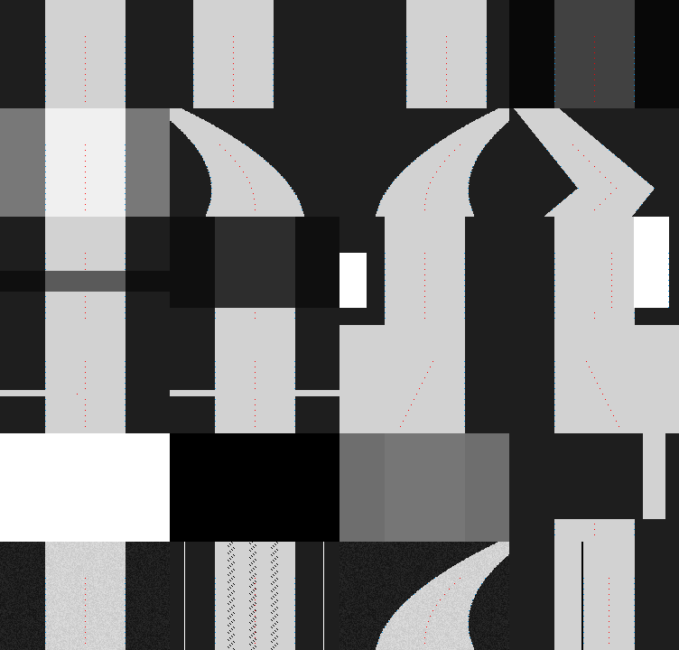

# 无硬件图像算法测试

本次测试直接调用 `demo/user/src/car_core.c` 的 `vision_process()`。视觉核心已改为逐行自适应阈值、边缘强度检查、连续道路段关联和有时效的实测宽度模型；测试不是 Python 中重新实现的算法。

## 执行

```powershell
python -m pip install --target .tools ziglang==0.16.0
python tests/run_tests.py
```

输出文件在 `tests/out/vision/`：每个代表场景的原始灰度 PGM、二值 PGM、叠加识别结果的 PNG、完整逐行数据 `results.jsonl`、可直接打开的 `report.html` 与汇总图 `overview.png`。输出目录不提交；运行测试会重新生成。图像尺寸均为 188×120，受测 ROI 固定为第 40～112 行、间隔 6 行。

新增 24 个代表场景与 128 个不同固定随机种子的噪声变体，共 152 个场景。此外单独检查 17 帧时序：13 帧赛道左右移动、3 帧全白丢线、1 帧恢复，算法历史不在帧间重置。

## 结果含义

- `ACCURATE/PASS`：必须输出有效赛道；双边界扫描行应与图像生成器的几何真值相差不超过 1 像素；直道整体偏差也必须准确，弯道偏差方向必须正确。
- `REJECT/PASS`：无赛道、长期单边缺失或突然移出搜索范围时，必须标记无效。局部有清晰道路边缘的阴影由逐行阈值恢复识别。
- `CHARACTERIZE/OBSERVE`：仅记录当前算法在困难场景中的表现，检查数组范围、坐标和有限数值，不代表准确识别通过。这两项不能计入成功率。

144 个准确识别用例与 6 个无效判定用例通过；2 个场景作为局限记录。另有 12 个弯道/退化/重捕获场景共 6,015 项检查通过。既有核心、控制、应用停车和采图工具测试也通过；camera/mock Keil 构建均为 0 Error(s), 0 Warning(s)。

噪声使用可复现的种子，几何真值来自预先定义的赛道边界。用变异副本分别颠倒偏差符号、使中线偏移 4 像素、把均匀图像强行判为有效；新增测试均检测到错误。变异只发生在忽略的临时输出目录，正式算法未修改。

## 已暴露的局限

| 场景 | 当前结果 | 意义 |
|---|---|---|
| 反光区域与右边界连成一片 | 仍判有效，整体偏差 +14.28 像素 | 合成场景仍将反光末端当作道路候选，需实拍回放继续调参 |
| 2 像素黑色内部竖条 | 记录为 OBSERVE | 可能被当作道路内部边界，不能用合成测试代替实车确认 |
| 120°镜头畸变/俯仰变化 | 未验证 | 当前宽度拟合为局部线性模型，需用真实 PGM 序列校准 |
| 赛道内连续两像素黑噪声 | 仍判有效，整体偏差 +16.50 像素 | 噪声符合当前两像素边界条件，后续需更可靠的边界筛选 |

干净直道基准偏差为 +0.50 像素，这是 188 宽图像中心 93.5 与本测试赛道中心 94 的差。上表偏差包含该基准差。

短边界断裂、温和阴影、背景反光和孤立椒盐噪声有明确通过用例；这不表示任意强度或形状的干扰都能处理。合成图不包含真实 120°镜头畸变、运动模糊、曝光响应及安装姿态，不能替代实车/真实图像验收。

## 24 场景汇总图

蓝色点为识别边界，红色点为识别中线；各格从左到右、从上到下依照下表排列。详细数值和单张图在本地 HTML 报告中查看。

| 行 | 第 1 格 | 第 2 格 | 第 3 格 | 第 4 格 |
|---|---|---|---|---|
| 1 | 直道 | 左偏直道 | 右偏直道 | 暗光 |
| 2 | 亮光 | 左急弯 | 右急弯 | S 弯 |
| 3 | 温和阴影 | 严重阴影 | 背景反光 | 反光连接边界（OBSERVE） |
| 4 | 短左边界断裂 | 短双边界断裂 | 左边长期缺失 | 右边长期缺失 |
| 5 | 全白 | 全黑 | 低对比 | 突然急转出搜索范围 |
| 6 | 灰度噪声 | 孤立椒盐噪声 | 弯道灰度噪声 | 成簇黑噪声（OBSERVE） |


